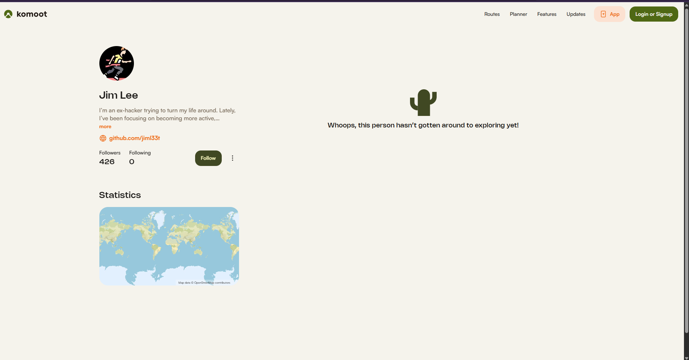
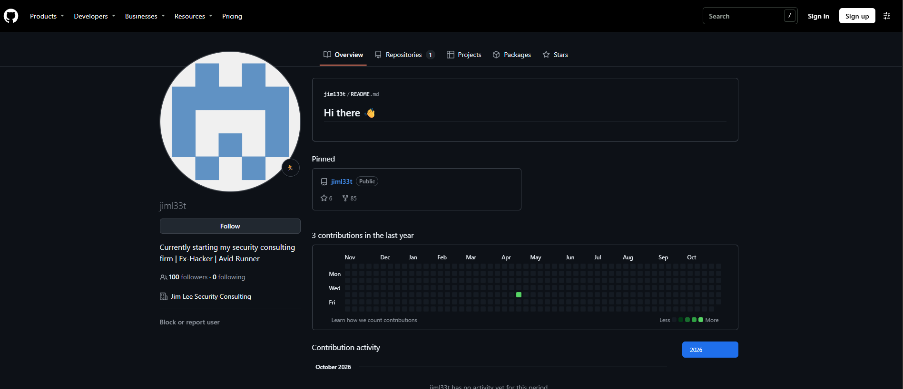
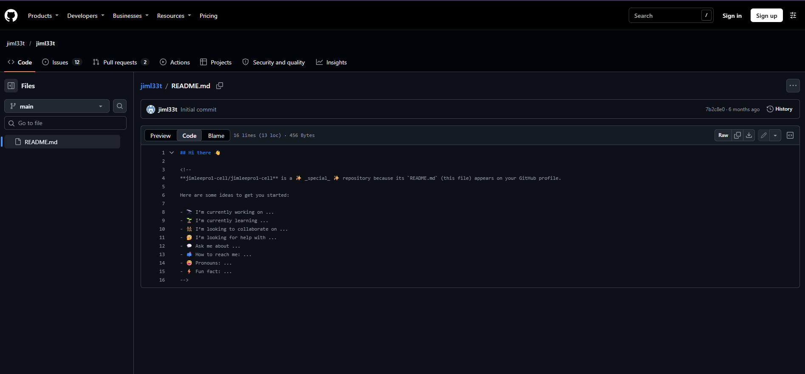
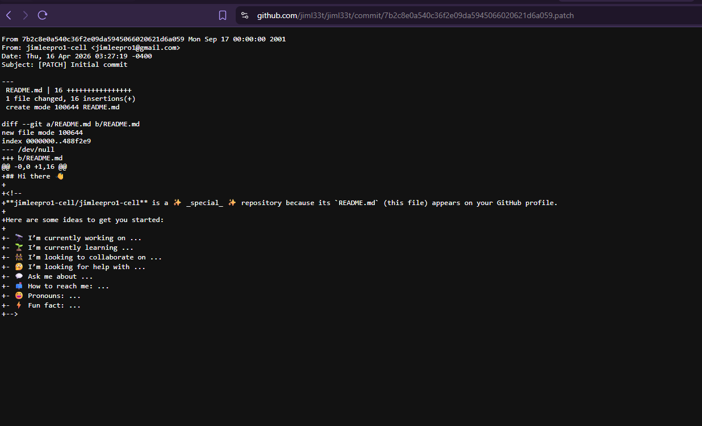
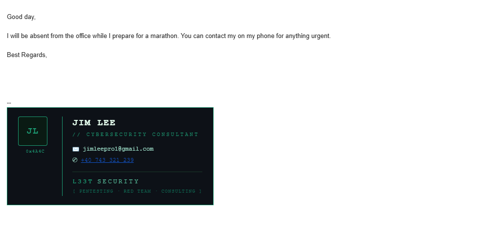
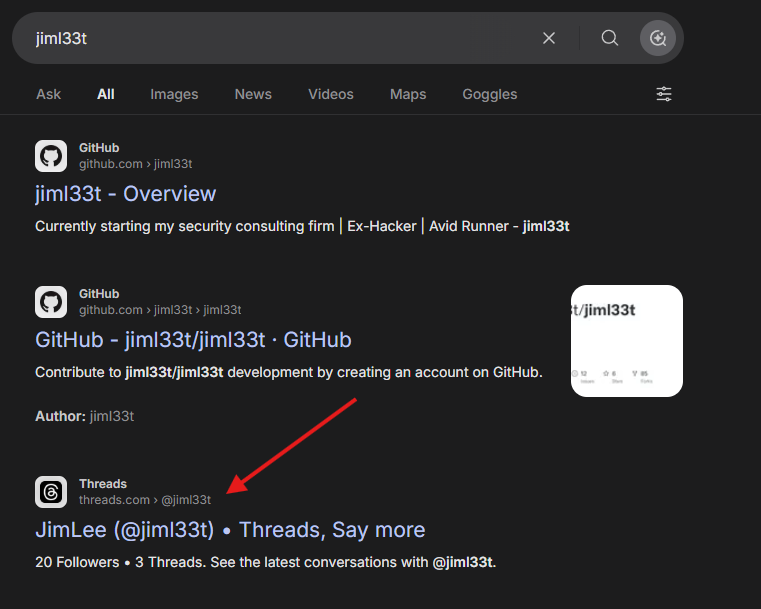
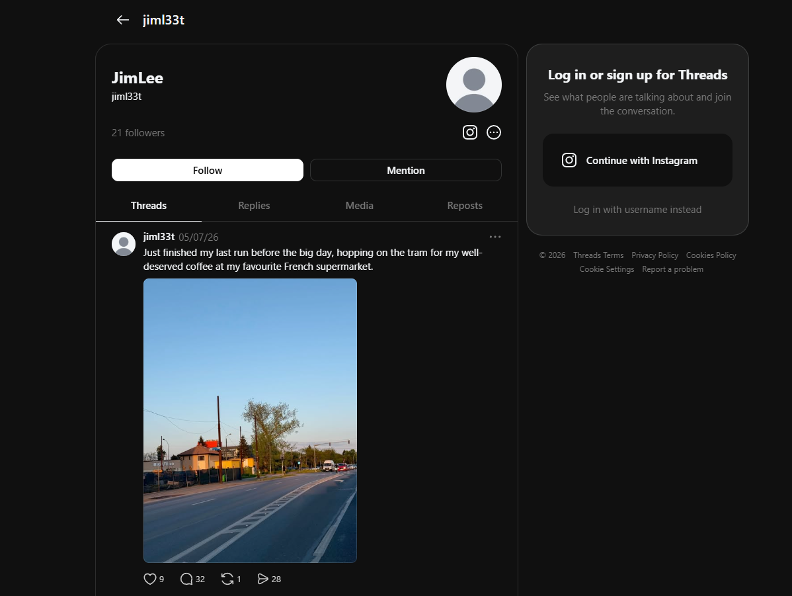
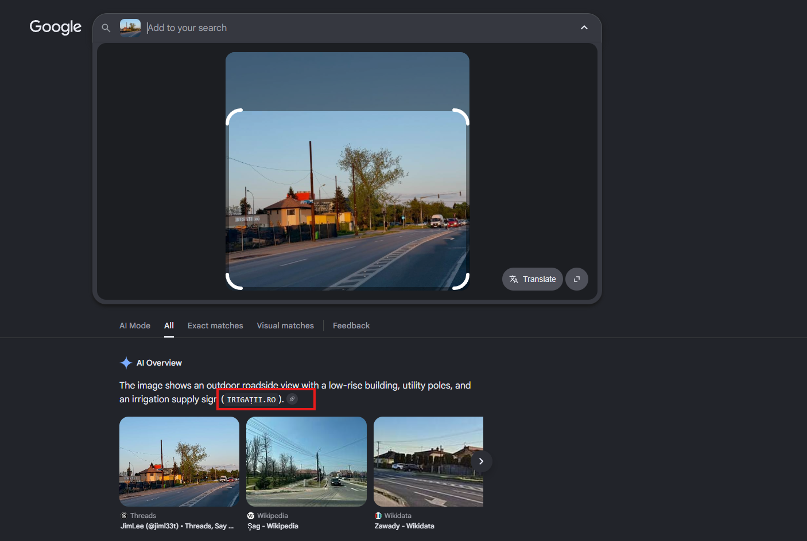
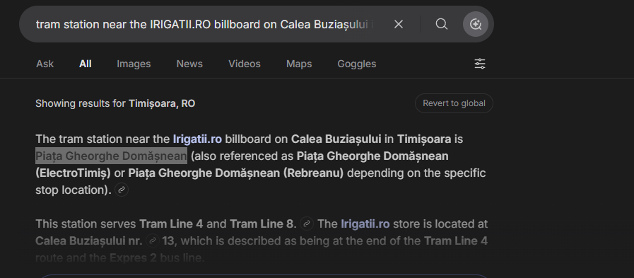

# Cache Me Outside — TryHackMe Walkthrough

[](https://tryhackme.com/room/cachemeoutside)
[]()
[]()


**Room:** https://tryhackme.com/room/cachemeoutside

> ⚠️ **Active OSINT Notice:** This room includes controlled interaction with discovered accounts and infrastructure. In real investigations, interacting with a target's accounts (emailing them, visiting their pages) can alert them and may require legal authorisation. Everything here is within a controlled lab setup.

---

## 1. Objective & Learning Goals

### What is this room about?

A retired hacker has left traces of his identity scattered across the public internet. Starting from a single leaked screenshot of a conversation, the task is to reconstruct his real identity, expose information he accidentally leaked, and pinpoint his physical location — using nothing but publicly available information.

### Security Concepts Covered

| Concept | What it means in practice |
|---------|--------------------------|
| **Digital footprint analysis** | How online accounts, usernames, and posts accumulate into a profile that reveals far more than intended |
| **Git commit metadata leakage** | How developer email addresses are embedded in every commit and exposed via `.patch` endpoints — even after the account "cleans up" |
| **Automated email response harvesting** | How auto-reply messages (out-of-office, vacation responses) can unintentionally expose phone numbers and secondary contact details |
| **Username pivoting** | How reusing a handle across multiple platforms (`jiml33t`) links otherwise separate accounts into one traceable identity |
| **Geolocation from image context** | How background details in images (billboards, street furniture, landmarks) can be used to pin a physical location |

---

## 2. Methodology

The investigation followed a standard OSINT chaining approach: each piece of information unlocks the next, building a picture from nothing but a starting point.

```
Leaked screenshot
      │
      ▼
Komoot profile URL → Real name + username
      │
      ▼
GitHub username → Repository → Commit → Email address
      │
      ▼
Email interaction → Auto-reply → Phone number
      │
      ▼
Username OSINT → Photo with billboard → Street address → City
      │
      ▼
Google Maps query → Nearest tram station
```

**Why this order?**

Each step produces a new data point that feeds the next search. OSINT investigations rarely go from zero to answer in one jump — the value is in knowing *what to do with each piece you find*, not in finding everything at once.

---

## 3. Commands & Evidence

### Step 1 — Starting Point: The Leaked Conversation

The room provides a screenshot of a conversation in which one participant (JJ) shares a Komoot profile URL:

```
https://www.komoot.com/user/5667624959835
```

**Why Komoot matters:**
Komoot is a hiking and cycling route-planning app. Users often set their real name as their display name (since it's a social fitness platform, not a privacy-focused service), and the profile may link to other social accounts. A Komoot profile URL with a numeric user ID is enough to pull up the full public profile.



The Komoot profile returned:
- **Full name:** `Jim Lee`
- **GitHub profile link** (listed in the profile)

**Answer — Q1:** `Jim Lee`

---

### Step 2 — GitHub Profile: Finding the Exposed Email

**Why check the GitHub profile next?**
GitHub was linked directly from the Komoot profile. More importantly, GitHub is where developers accidentally expose information — commit histories contain the author's name and email address for every single commit, and these are public by default.

The GitHub username was **`jiml33t`**. His profile repository (`jiml33t/jiml33t`) contained a custom README.





#### The `.patch` Trick

Every GitHub commit can be viewed as a raw patch file by appending `.patch` to the commit URL:

```
https://github.com/jiml33t/jiml33t/commit/7b2c8e0a540c36f2e09da5945066020621d6a059.patch
```

**Why this works:**
Git's patch format embeds the author's name and email address in the file header:

```
From: Jim Lee <jimleepro1@gmail.com>
```

This data is baked into the commit object at the moment the commit is created, using whatever email address was configured in `git config user.email` on the developer's machine at the time. **Changing the email later, or deleting the repository, does not remove it from GitHub's commit history** — and the `.patch` endpoint exposes it in plaintext.



**Answer — Q2 (exposed email):** `jimleepro1@gmail.com`

---

### Step 3 — Email Interaction: Harvesting the Auto-Reply

After standard OSINT lookups against the email address returned no results, the next step was **active OSINT** — sending an email directly to the address and observing the response.

```
To: jimleepro1@gmail.com
Subject: [anything]
Body: [anything]
```

**Why send an email?**
Many people configure out-of-office or vacation auto-replies that include personal contact information — a phone number "for urgent matters", a secondary email, or a work address. This is especially common when someone is traveling or transitioning between roles. The auto-reply fires automatically without requiring the target to do anything.

The email bounced back an **automated vacation response** containing a phone number.



**Answer — Q3 (phone number):** `+40 743 321 239`

The country code `+40` identifies Romania — narrowing the geographic region for the location tasks that follow.

---

### Step 4 — Username OSINT: Finding a Geotagged Photo

**Why search the username `jiml33t` across platforms?**
People reuse usernames across many services. The username `jiml33t` was already confirmed on GitHub and Komoot. Running it through OSINT search tools (Google, Sherlock, WhatsMyName) finds other platforms where the same handle appears.

A search for `jiml33t` returned results on another platform where Jim had posted a photo.



The photo contained a visible **billboard for IRIGAȚII.RO** in the background — a Romanian irrigation equipment company.



**Why does a billboard help?**
Commercial billboards are placed at specific, registered locations. A billboard for a local Romanian company at a street-level viewpoint can be matched against Google Maps Street View, business listings, or the company's own registered address to identify the exact road.

Searching `IRIGAȚII.RO` returned the company's registered location:

```
Calea Buziașului, Timișoara, Romania
```



**Answer — Q4 (city):** `Timișoara`

---

### Step 5 — Geolocation: Finding the Tram Station

**Context:** The room states the photo was taken on **7 May 2026**, and we need to identify the tram station where he got off.

**Why a tram station?**
Timișoara has a tram network. The photo was taken on or near Calea Buziașului, and the question asks for the nearest tram stop — implying this was how he arrived at the location where the photo was taken.

**Search query used:**

```
tram station near the IRIGATII.RO billboard on Calea Buziașului in Timișoara, Romania
```

**Why phrase the query this way?**
Anchoring the search to both the street name and the specific landmark (the billboard) reduces ambiguity — Calea Buziașului is a long road and could have multiple tram stops. Specifying the landmark helps Google return the closest one.



**Answer — Q5 (tram station):** `Piața Gheorghe Domășnean`

---


---

## 4. Vulnerability Analysis

### Root Cause: The Digital Footprint Problem

This room demonstrates that **privacy is not a binary setting** — it's a cumulative property of every account, post, and action you take online. Jim Lee made no single catastrophic mistake. What he did was:

1. Use a **consistent username** (`jiml33t`) across a fitness app, GitHub, and at least one other platform.
2. Commit code with his **personal email address** without realizing it's permanently embedded in public commit history.
3. Configure an **auto-reply** on a semi-public email address that revealed personal contact information.
4. Post a **photo with an identifiable billboard** in the background without considering what the background reveals.

None of these individually would be enough. Together, they form a complete profile.

### Prerequisites for This Attack

| Requirement | Why |
|-------------|-----|
| A starting data point | Here: the Komoot URL in the leaked screenshot |
| Username reuse by the target | Connects otherwise unlinked accounts |
| Public commit history | GitHub is public by default |
| Auto-reply configured with personal info | A human decision to include a phone number in an automated response |
| A photo posted publicly with identifiable background content | No geotag needed — visual context is enough |

### Impact

In a real-world scenario:

- Full name, email, phone number → sufficient for **phishing**, **SIM swapping**, or **social engineering**
- Physical city + commute route + date → sufficient to narrow **physical surveillance**
- GitHub history → further technical profiling (languages used, projects worked on, coding style)

### How Confidence Was Established at Each Step

| Step | Confirmation method |
|------|---------------------|
| Name | Komoot profile — public, first-party data |
| Email | Git commit `.patch` — cryptographically tied to the commit object |
| Phone | Auto-reply from the email address itself — direct response |
| City | Company registration + street-visible billboard match |
| Tram stop | Geographic proximity query against known street address |

---

## 5. Remediation & Lessons Learned

### How to Fix Each Leak

**1. Git commit email exposure**

```bash
# Set a privacy-preserving email before committing
git config --global user.email "username@users.noreply.github.com"
```

GitHub offers a no-reply address (`<username>@users.noreply.github.com`) specifically so developers can commit without exposing their real email. Enabling "Block command line pushes that expose my email" in GitHub settings enforces this automatically.

To rewrite existing history and remove a real email, `git filter-repo` or `BFG Repo Cleaner` can be used — but this rewrites every commit hash and breaks forks.

**2. Auto-reply content**

Never include personal phone numbers, home addresses, or secondary contact details in automated email responses on addresses that appear publicly or semi-publicly. Use a work phone number or a redirect form if contact is needed.

**3. Username reuse**

Use different usernames across platforms that serve different purposes (professional vs. personal vs. anonymous). A username used on GitHub should not appear on a fitness tracking app and vice versa.

**4. Photo OPSEC**

Before posting a photo publicly, check the background for:
- Billboards or signage with business names or addresses
- Street furniture (tram stops, bus routes, distinctive lamp posts)
- Shop fronts or building facades
- Reflections in windows

If any of these appear, crop or blur them before posting. EXIF metadata (which stores GPS coordinates if location services were on) should also be stripped — tools like `exiftool -all= photo.jpg` remove it in one command.

### Lessons Learned

**The `.patch` trick is underused in OSINT.**
Most people know to look at a GitHub profile. Fewer think to look at individual commit patch files. This technique works on any public repository and doesn't require special tools — just knowing the URL pattern.

**Active OSINT requires judgment.**
Sending an email to a target is interaction. In a real investigation, this can tip off a suspect, create legal complications, or contaminate evidence. The decision to go active should be deliberate, documented, and authorised.

**OSINT chains are stronger than individual data points.**
No single finding here was decisive. The value came from chaining: Komoot → GitHub → email → auto-reply → username → photo → billboard → company → street → tram stop. This is what OSINT investigators actually do — build a chain, not a single search.

**False start — email lookup tools:**
Before sending the email, several passive tools (HaveIBeenPwned, email OSINT aggregators) were checked for the address and returned nothing useful. This is a good reminder that passive tools have gaps — active interaction is sometimes the only way forward, and when used appropriately, it yields what passive search cannot.

---

## OSINT Toolkit Summary

| Tool / Method | Used For |
|---------------|----------|
| Komoot (public profile) | Real name, linked accounts |
| GitHub `.patch` endpoint | Embedded email in commit metadata |
| Direct email interaction | Auto-reply harvesting (phone number) |
| Username search (Google / Sherlock) | Cross-platform pivot on `jiml33t` |
| Google reverse image / Maps | Billboard identification, street location |
| Google search (company name) | Registered address → city |
| Google Maps + keyword query | Nearest tram station |

---

## Disclaimer

This walkthrough documents work performed on a TryHackMe lab room for educational and portfolio purposes. All OSINT was conducted within a controlled lab environment against fictional identities. In real-world investigations, always operate within legal boundaries and with proper authorisation.
